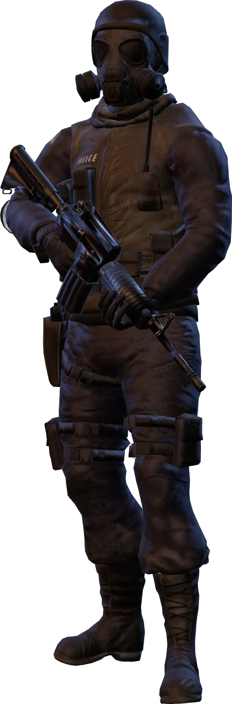
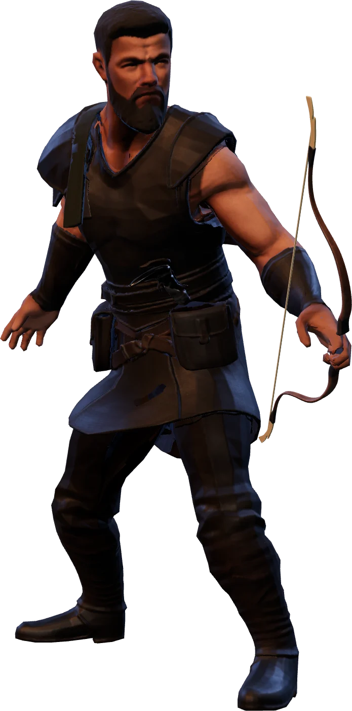
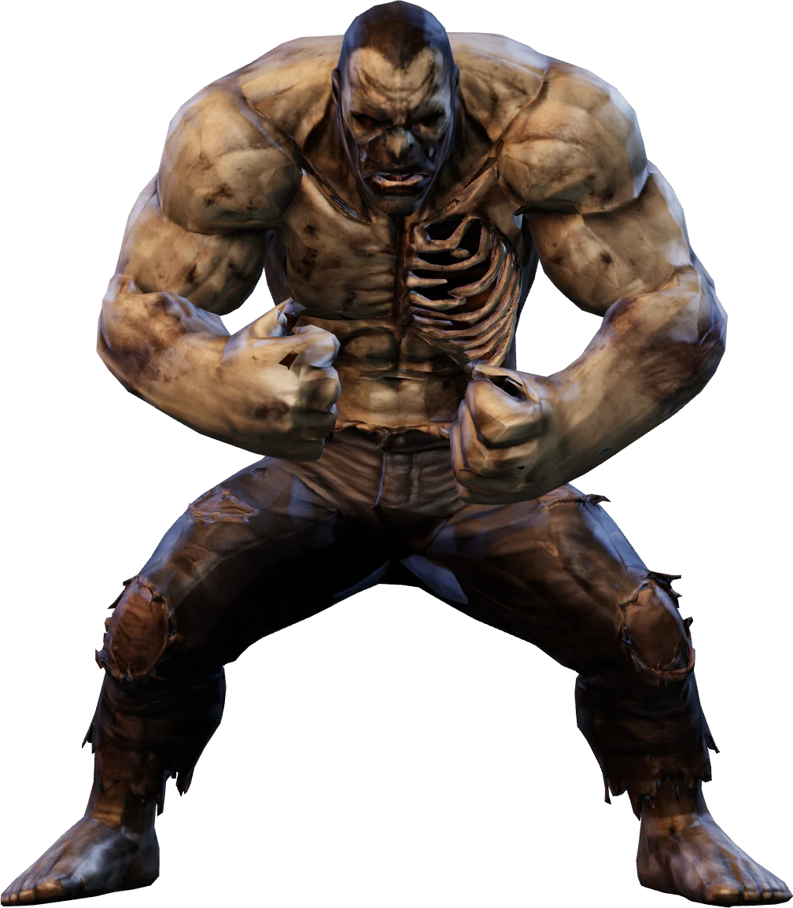
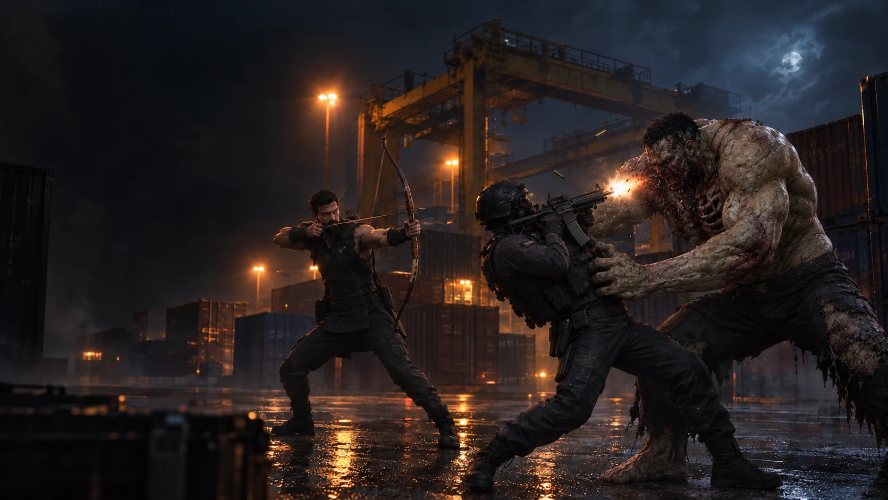

# FERAL

**Early development build — not released yet.** Expect things to change and break.

FERAL is a multiplayer zombie tag FPS that runs in the browser. One player turns into the zombie and hunts everyone else; the survivors just have to make it to the end of the round. It's set in a container yard at night, and rounds last 150 seconds.

Built with three.js, Vite, and a small Node WebSocket server that handles all the game logic.

## Characters

Every round, one random player becomes the zombie (never the same person twice in a row). Everyone else picks a survivor class in the lobby.

<table>
  <tr>
    <th width="33%">SWAT</th>
    <th width="33%">Hunter</th>
    <th width="33%">Zombie</th>
  </tr>
  <tr>
    <td align="center"></td>
    <td align="center"></td>
    <td align="center"></td>
  </tr>
  <tr>
    <td valign="top">
      <b>Survivor · Gunner</b><br><br>
      Carries an <b>M4 rifle</b> (full auto, 30 rounds) and a <b>pistol</b> (14 rounds) as backup.
      Lots of damage up close, but ammo runs out. Pick up ammo crates around the map to keep shooting.
    </td>
    <td valign="top">
      <b>Survivor · Archer</b><br><br>
      Uses a <b>bow with unlimited arrows</b>, so no reloading and no ammo hunting.
      Hold to draw and release to fire. A full draw hits hard and flies far, and a full-draw headshot does double damage.
      You move slowly while drawing, so timing matters.
    </td>
    <td valign="top">
      <b>The predator</b><br><br>
      Big, tanky, and slowly regenerates health. Gets tougher the more survivors there are.
      Stuck in place for the first 5 seconds of the round.
      Can <b>super jump</b> and slam the ground for area damage, and go into <b>rage</b> to outrun every survivor and heal fast for a few seconds.
    </td>
  </tr>
</table>

### Getting downed

Survivors don't die right away. At zero health you go down and can still crawl slowly while you bleed out (25 seconds).
A teammate can hold **F** next to you to do CPR and get you back up. Your bleed-out timer pauses while you're getting CPR.
If the zombie hits you while you're down, you bleed out faster.

## Controls

**Everyone**

| Key | Action |
|---|---|
| WASD | Move |
| Shift | Sprint (uses stamina) |
| Mouse | Look around |
| Ctrl + 1 / 2 / 3 | Dance |
| Esc | Menu |

**By character**

| Key | SWAT | Hunter | Zombie |
|---|---|---|---|
| Left click | Shoot (hold for full auto with the rifle) | Hold to draw, release to shoot | Punch |
| R | Reload | (no reload needed) | Rage |
| 1 / 2 | Switch to rifle / pistol | | |
| Space | Jump | Jump | Tap to jump. Hold, then release to super jump |
| Hold F | CPR on a downed teammate | CPR on a downed teammate | |

The settings menu has mouse sensitivity, volume, graphics quality, and a Korean/English toggle. If your laptop runs hot, set graphics to Low.

You can start a solo practice round against bots from the lobby. Practice only puts you in the game; anyone else in the lobby can still start a real match, and you'll get the ready check too.

## PLAY NOW
<p align="center">
  
</p>

<p align="center">
  <a href="https://feralfps.duckdns.org:8443">
    
  </a>
  &nbsp;
  <a href="https://hanseidon.itch.io/feral">
    
  </a>
</p>

> [!NOTE]
> Early development build. The server might go down or reset at any time.

## Running it locally

```bash
npm install
npm run dev
```

Then open http://localhost:5173. This starts both Vite and the game server (port 3000), and both reload automatically when you change code. You need two players to start a real round; two browser windows on the same machine work fine.

Add `?offline` to the URL if you only want to work on the menus and UI without connecting to the server.

All the balance numbers live in `shared/config.js` and `shared/loadout.js`. Both the server and the client read them.

## Deploying

```bash
npm run pack
```

This builds the client and bundles it with the server into `feral.tgz`. In production, one Node process serves both the static files and the WebSocket on a single port.

The `deploy/` folder has scripts for an Ubuntu box:
- `setup.sh`: Node 22, Caddy for automatic HTTPS, and a systemd service
- `update.sh`: swaps in a new build
- `gcp.sh`: does the same steps from Google Cloud Shell

For itch.io, `npm run pack:itch` builds just the client with the game server's address baked in and zips it to `~/Downloads/feral-itch.zip` (pass a different `wss://…/ws` address to point it elsewhere). The round-start music is left out of that build.

## Project layout

```
shared/   game config, map collision, network protocol (used by server and client)
server/   authoritative game server, rounds, practice bots and their pathfinding
src/      client: input, networking, player, combat, animation, map, audio, UI
public/   models, textures, sounds, UI art
tools/    asset build scripts (turn source FBX/glTF files into the lightweight GLBs in public/)
deploy/   server setup and update scripts
```

The asset build scripts read source files that aren't in this repo. You only need them to rebuild the models, not to run the game.

## Credits

- 3D models and textures: Sketchfab (CC BY 4.0) and Poly Haven (CC0). Full attribution is in [`public/models/CREDITS.md`](public/models/CREDITS.md).
- Character animations: Adobe Mixamo.
- Sound effects: [Freesound](https://freesound.org).
- The round-start music isn't included in this repo for licensing reasons. The game just skips it if the file is missing.

## License

All rights reserved. The source is public so people can read it, but please don't copy, modify, or redistribute it. Third-party assets are covered by their own licenses.
